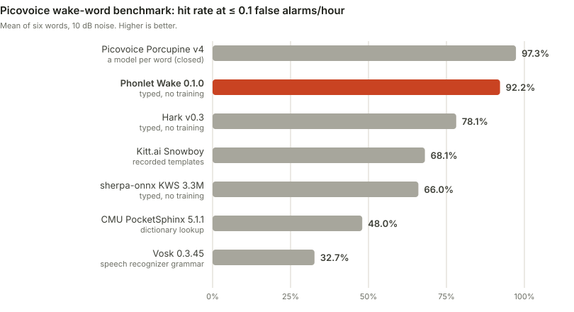

<p align="center">
  
</p>

# Phonlet Wake

On-device wake-word detection for any phrase you can type. One small English model listens for
several phrases at once, offline, with a sensitivity for each. A new phrase is data: its
pronunciations and two calibrated thresholds, made from text in seconds. No recordings, no
training runs, no cloud.

[Website](https://phonletai.com) · [Try it live](https://phonletai.com/#lab) ·
[Generator](https://phonletai.com/generator) · [Docs](https://phonletai.com/docs) ·
[For AI agents](https://phonletai.com/agents.md) ·
[Downloads](https://github.com/phonlet-ai/wake/releases/latest) ·
[Hugging Face](https://huggingface.co/phonletai/wake-en-1)

## Footprint

| | |
| --- | --- |
| Model | `en-1`, 1,013,825 bytes of int8 weights, the same file for every phrase |
| Memory while listening | about 1.05 MB (C API, Linux x64, four phrases); each extra phrase adds about 1.5 KB |
| Laptop | 0.7% of one core (AMD Ryzen 7 7735HS, native, 327 s of speech in 2.25 s) |
| Browser | about 8% of one core on the same laptop (WebAssembly in a worker) |
| ESP32-S3 | 19% of one 240 MHz core; weights in 75 KB of internal RAM plus 934 KB of PSRAM |

Audio goes in as 16 kHz mono signed 16-bit PCM, in chunks of any size; the engine works in 32 ms
frames and reports each detection with its phrase and time.

## Benchmark

On [Picovoice's public wake-word benchmark](https://github.com/Picovoice/wake-word-benchmark), with
phrases typed as text: hit rate at 0.1 false alarms per hour, 10 dB noise, mean of six words.



| Engine | How a wake word is made | Hit rate, 10 dB |
| --- | --- | ---: |
| Picovoice Porcupine v4 | a model per word (closed) | 97.3% |
| **Phonlet Wake 0.1.0** | typed, no training | **94.9%** |
| Hark v0.3 | typed, no training | 78.1% |
| Kitt.ai Snowboy | recorded templates | 68.1% |
| sherpa-onnx KWS 3.3M | typed, no training | 66.0% |

Without noise Phonlet Wake reaches 99.2%. Per-word results, sources and the method:
[benchmark](docs/benchmark.md).

## Get started

**1. Make a keyword file.** Type your phrases in the [generator](https://phonletai.com/generator)
(it runs in your browser) and download `keywords.json`, or use the command-line generator:

```sh
curl -LO https://github.com/phonlet-ai/wake/releases/download/v0.1.0/wake-threshold-0.2.0-x86_64-unknown-linux-musl
chmod +x wake-threshold-0.2.0-x86_64-unknown-linux-musl
./wake-threshold-0.2.0-x86_64-unknown-linux-musl "hey nova" "okay kettle" --out keywords.json
```

Words missing from the 394,000-word dictionary get a predicted pronunciation; you can also write
the sounds yourself (`"zorblax=Z AO R B L AE K S"`). The file names the model it belongs to:

```json
{
  "model": {"id": "en-1", "sha256": "8be3687d060f953d0069480cf53d1fd0aa66e04551c2a4b600823a992a864af8"},
  "keywords": [
    {"name": "hey nova", "pronunciations": [[16, 13, 23, 25, 35, 3]],
     "threshold_loose": -1.267578125, "threshold_strict": -0.9033203125, "endpoint": false,
     "metadata": {"source": "lexicon", "warnings": []}}
  ],
  "metadata": {"generator": "wake-threshold 0.2.0"}
}
```

**2. Install the SDK and the model** for your platform from the
[latest release](https://github.com/phonlet-ai/wake/releases/latest), for example Python:

```sh
pip install https://github.com/phonlet-ai/wake/releases/download/v0.1.0/phonlet_wake-0.1.0-py3-none-linux_x86_64.whl \
            https://github.com/phonlet-ai/wake/releases/download/v0.1.0/phonlet_wake_model_en-0.1.0-py3-none-any.whl
```

**3. Listen.**

```python
from phonlet_wake import Wake
from phonlet_wake_model_en import english  # the en-1 model file, from the model wheel

with Wake.create(model=english["model"], keywords="keywords.json", sensitivity=0.5) as wake:
    for pcm in microphone_chunks():  # 16 kHz mono int16, any chunk size
        for hit in wake.process(pcm):
            print("Wake word:", hit.keyword, hit.time_seconds)
```

Every SDK takes the keyword file as a path (or URL), as the parsed object, or as phrases written in
code. See [phrases and keyword files](docs/keywords.md).

## Downloads

Release [v0.1.0](https://github.com/phonlet-ai/wake/releases/tag/v0.1.0); every file is listed in
`SHA256SUMS`. The model is also on Hugging Face as
[phonletai/wake-en-1](https://huggingface.co/phonletai/wake-en-1), and the lab runs as the
[phonletai/wake](https://huggingface.co/spaces/phonletai/wake) Space.

| File | What it is |
| --- | --- |
| `phonlet-wake-en-1.pwake` | The `en-1` model, for every SDK |
| `phonlet-wake-en-1-keywords.json` | Five English phrases as a keyword file (hey phonlet, ok phonlet, hey assistant, assistant, hey wake) |
| `wake-threshold-0.2.0-x86_64-unknown-linux-musl` | The threshold generator: phrases in, keyword file out (static Linux x64 binary) |
| `wake-threshold-0.2.0.wasm` | The same generator as WebAssembly ([interface](generator/README.md#webassembly)) |
| `wake-native-0.1.0-linux-x64-gnu.tar.gz` | C / C++: `phonlet_wake.h`, `libkws_engine.so`, a command-line detector |
| `wake-native-0.1.0-windows-x64.zip` | C / C++ and .NET on Windows: `kws_engine.dll`, its import library and the header |
| `phonlet_wake-0.1.0-py3-none-linux_x86_64.whl`, `phonlet_wake_model_en-0.1.0-py3-none-any.whl` | Python SDK (CPython 3.11+, Linux x64) and the model package |
| `phonlet-ai-wake-node-0.1.0.tgz`, `phonlet-ai-wake-node-linux-x64-gnu-0.1.0.tgz`, `phonlet-ai-wake-model-en-0.1.0.tgz` | Node.js SDK, its Linux x64 native add-on, the model package |
| `phonlet-ai-wake-web-0.1.0.tgz`, `phonlet-ai-wake-react-0.1.0.tgz` | Browser SDK (WebAssembly in a worker) and the React hook |
| `phonlet-wake-android-0.1.0.aar` | Android library (arm64-v8a, armeabi-v7a, x86_64) |
| `wake-demo-{native,nodejs,python,web}-0.1.0.tar.gz` | Runnable demos |

Node.js: `npm install` the three Node tarballs together (their URLs work too). .NET: use
`kws_engine.dll` from the Windows zip with [`sdk/dotnet`](sdk/dotnet/README.md). ESP32-S3: add the
ESP-IDF component in [`sdk/esp32/wake`](sdk/esp32/wake/README.md) and embed the model and your
keyword file. macOS and other targets: build from source (below).

The Linux x64 native libraries (C, Python, Node.js) need glibc 2.32 and the libstdc++ of GCC 11 or
newer (Ubuntu 22.04, Debian 12, RHEL 9 or later). The generator binary is static and runs on any
x64 Linux.

## Platforms

| Platform | SDK | Status |
| --- | --- | --- |
| Python | [`sdk/python`](sdk/python/README.md) | Tested on CPython 3.12, Linux x64 |
| Node.js | [`sdk/nodejs`](sdk/nodejs/README.md) | Tested on Node 24, Linux x64 |
| Browser | [`sdk/web`](sdk/web/README.md) | Tested in Chromium (WebAssembly, scalar and SIMD) |
| React | [`sdk/react`](sdk/react/README.md) | Hook over the browser SDK; lifecycle tests |
| C / C++ | [`include/phonlet_wake.h`](include/phonlet_wake.h), [examples](demos/native/README.md) | Tested on Linux x64 and Windows x64 |
| Java | [`sdk/java`](sdk/java/README.md) | Tested on JDK 17, Linux x64 |
| Android | [`sdk/android`](sdk/android/README.md) | Tested on a phone (Android 16, arm64): live microphone detections |
| .NET | [`sdk/dotnet`](sdk/dotnet/README.md) | Tested on .NET 8, Windows x64 |
| ESP32-S3 | [`sdk/esp32/wake`](sdk/esp32/wake/README.md) | Tested on an ESP32-S3-N16R8 with an INMP441: spoken phrases detected live |

Every SDK runs the same engine, so the same phrase gives the same detections everywhere.

## How it works

The engine turns audio into a log-mel spectrogram, runs a streaming minGRU acoustic model that
outputs English phone probabilities every 32 ms, and scores each phrase's pronunciations against
them; a phrase fires when its score passes the threshold set by its sensitivity. Read
[how it works](docs/engine.md), [phrases and keyword files](docs/keywords.md) and the
[documentation index](docs/README.md).

## Repository

| Path | Contents |
| --- | --- |
| [`engine/`](engine/) | C++17 engine, its CMake build and the WebAssembly build |
| [`include/`](include/) | The public C API |
| [`sdk/`](sdk/) | One directory per platform SDK |
| [`generator/`](generator/README.md) | `wake-threshold`, the threshold generator (Rust; also WebAssembly) |
| [`demos/`](demos/README.md) | Runnable examples for each SDK |
| [`resources/`](resources/README.md) | The `en-1` model and the English keyword file |
| [`packaging/`](packaging/) | Model and native-library packages; the Hugging Face model card, lab Space and organisation card ([`scripts/publish-huggingface.sh`](scripts/publish-huggingface.sh)) |
| [`docs/`](docs/README.md) | How it works, keyword files, the benchmark, the SDK contract, development |
| [`scripts/`](scripts/), [`tests/`](tests/) | Build, packaging, repository gate and tests |
| [`research/benchmark/`](research/benchmark/README.md) | The benchmark harness and its results |

## Build from source

```sh
python scripts/test.py --quick                     # gate, Python tests, WebAssembly smoke test
python scripts/test.py                             # everything, including packaging and installs
(cd generator && cargo test --release)             # the generator's parity suite
```

See the [development guide](docs/development.md) for toolchains and per-platform builds.

## Licence

Phonlet Wake (code, the `en-1` model and the generator) is licensed under the [PolyForm
Noncommercial License 1.0.0](LICENSE): free for personal use, study, research with no commercial
aim, charities, schools, public research and government. A product you sell, a device you ship or a
service your company runs needs a commercial licence: see [COMMERCIAL.md](COMMERCIAL.md) or write to
contact@phonletai.com. Third-party components and training data are listed in
[THIRD_PARTY_NOTICES.md](THIRD_PARTY_NOTICES.md).
