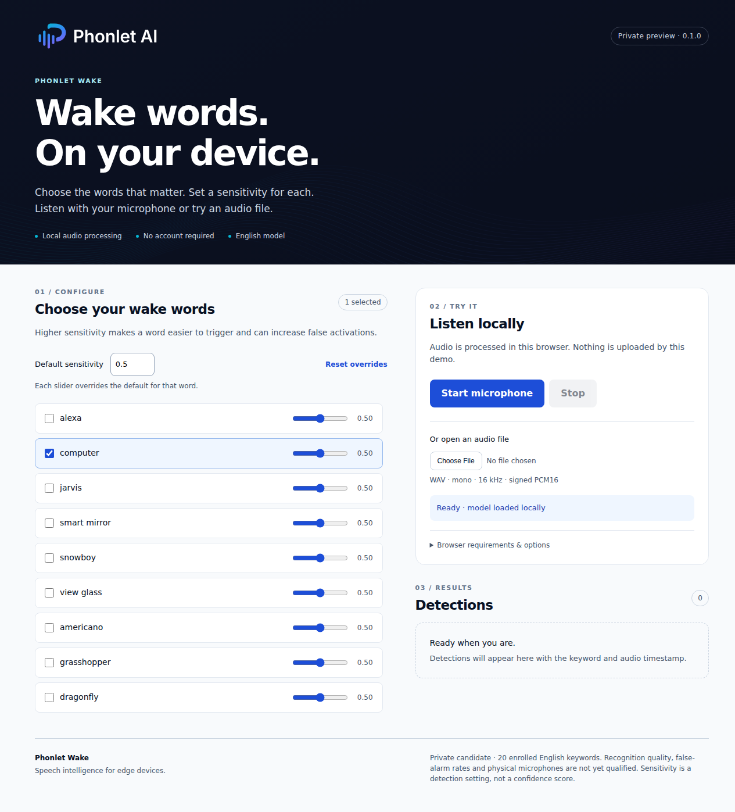

# Phonlet Wake demos

Each demo runs one SDK on real audio, entirely on the device.

| Demo | Input | Instructions |
| --- | --- | --- |
| Browser | Microphone or WAV upload | [web](web/README.md) |
| Node.js | WAV file or ALSA microphone | [nodejs](nodejs/README.md) |
| Python | WAV file or PortAudio microphone | [python](python/README.md) |
| C / C++ | Raw 16 kHz PCM file | [native](native/README.md) |
| Java | Raw 16 kHz PCM file | [java](java/README.md) |
| Android | Microphone (AudioRecord) | [android](android/README.md) |
| .NET | Raw 16 kHz PCM file | [dotnet](dotnet/README.md) |
| ESP32-S3 | INMP441 I2S microphone, LED and serial output | [esp32](esp32/README.md) |
| ESP32-S3 microphone check | INMP441 wiring test with an LED level meter | [esp32-mic-check](esp32-mic-check/README.md) |

Audio is mono, 16 kHz, signed 16-bit PCM; the WAV examples reject other formats. Higher
sensitivity makes a phrase easier to trigger and can increase false alarms. The demos use the
English pack's five phrases; to use your own, see [phrases and keyword files](../docs/keywords.md).
