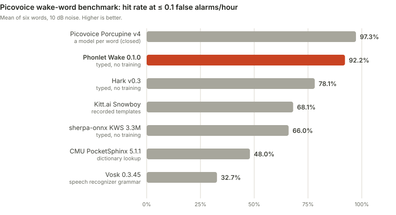

# Benchmark: Picovoice's wake-word benchmark

Phonlet Wake 0.1.0 (`en-1`, phrases typed as text) on
[Picovoice's public wake-word benchmark](https://github.com/Picovoice/wake-word-benchmark). Run of
2026-11-27. Method, code and how to rerun it: [`research/benchmark/`](../research/benchmark/README.md).

## Results

Hit rate at no more than 0.1 false alarms per hour, 10 dB DEMAND noise, mean of six words. Phonlet
Wake measured here; other engines as published (sources below).

| Engine | How a wake word is made | Hit rate, 10 dB |
| --- | --- | ---: |
| Picovoice Porcupine v4 | a model per word (closed) | 97.3% |
| **Phonlet Wake 0.1.0** | typed, no training | **94.9%** |
| Hark v0.3 | typed, no training | 78.1% |
| Kitt.ai Snowboy | recorded templates | 68.1% |
| sherpa-onnx KWS 3.3M | typed, no training | 66.0% |
| CMU PocketSphinx 5.1.1 | dictionary lookup | 48.0% |
| Vosk 0.3.45 | speech recognizer grammar | 32.7% |

| Word | Phonlet Wake, 10 dB | Phonlet Wake, clean | sherpa-onnx, 10 dB | Hark v0.3, 10 dB | openWakeWord, 10 dB | microWakeWord, 10 dB |
| --- | ---: | ---: | ---: | ---: | ---: | ---: |
| alexa | 94.9% | 99.4% | 82.9% | 78.4% | 87.9% | 89.5% |
| computer | 96.1% | 99.8% | 63.3% | 64.2% | 0.0% | n/a |
| jarvis | 96.4% | 99.0% | 57.6% | 78.4% | 63.3% | n/a |
| smart mirror | 98.4% | 99.2% | 66.1% | 85.1% | n/a | n/a |
| snowboy | 93.0% | 98.5% | 69.3% | 83.5% | n/a | n/a |
| view glass | 90.5% | 99.2% | 57.1% | 79.2% | n/a | n/a |
| **mean** | **94.9%** | **99.2%** | 66.0% | 78.1% | partial | partial |

## Notes

- As for every engine in the table, each word's threshold is the best one within the false-alarm cap.
- `en-1` was never trained on LibriSpeech test-clean, DEMAND or Picovoice's recordings. Details and
  caveats: [the method](../research/benchmark/README.md).

## Versions

- Model `resources/models/en-1/model.pwake`, SHA-256 `8be3687d060f953d0069480cf53d1fd0aa66e04551c2a4b600823a992a864af8`
- Keyword files from `wake-threshold 0.2.0 --endpoint` (the v0.1.0 release binary)
- Engine `libkws_engine` 0.1.0 built from this repository; detection through its C API, proven
  identical to `phonlet_wake_process` (`wwb.py --check`)
- Data: Picovoice/wake-word-benchmark at `84919190`, LibriSpeech test-clean (OpenSLR), DEMAND 16 kHz
  (17 environments)
- Results: [`research/benchmark/results/2026-11-27-endpoint.json`](../research/benchmark/results/2026-11-27-endpoint.json)
- Other engines, as published: Porcupine, Snowboy and PocketSphinx by
  [Picovoice](https://github.com/Picovoice/wake-word-benchmark); Hark, sherpa-onnx, Vosk,
  openWakeWord and microWakeWord in
  [Hark's benchmark results](https://github.com/pioborgelt/hark/blob/45a01d974c03937d0f581dbdd0c4c08ad17618e0/docs/BENCHMARKS.md)
  (2026-11-20)
