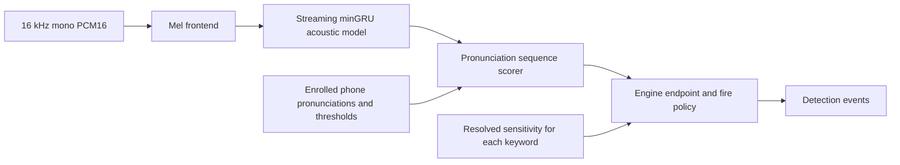

> Design and compatibility reference. Each SDK's README describes its implemented surface; the
> [main README](../../README.md#platforms) lists where each one has been tested.

# Wake SDK contract

The rules every SDK follows: lifecycle, options, events, errors and the keyword format. The
Node.js, browser and Python SDKs implement all of it, including per-phrase sensitivity with a shared
default and the model check of keyword files; the C API and the SDKs built on it follow the same detection and
lifecycle rules with a smaller surface.

## 1. Integration pattern

Wake follows one integration pattern across every SDK: initialize with model,
keyword and sensitivity configuration, submit mono PCM, receive typed
detection events, then release resources.



The implementation in [session.cc](../../engine/src/session/session.cc) buffers
arbitrary PCM chunks into 512 samples. Two 256-sample frontend hops produce
80 stacked features for one 32 ms acoustic step. The deployed English model
has six minGRU layers of width 162, int8 matrix storage and float cell arithmetic.
Its 40 output classes are the ordered English phones plus blank.

The [production scorer](../../engine/src/detector/scorer.cc) follows each enrolled
pronunciation through those in-memory acoustic outputs. It combines pronunciations
and, where requested by the keyword artifact, applies endpoint gating. The
[detector](../../engine/src/detector/detector.cc) applies the selected thresholds,
debounce and keyword arbitration. Sessions maintain frontend, acoustic and
detector state and apply the engine's inactivity resets. None of this belongs in
language-specific SDK scoring code. Frame posteriors are not saved.

There are two separate flows:

| Operation | Inputs | Result |
| --- | --- | --- |
| Enroll a new phrase | Text to the separate threshold service, using its lexicon and calibration assets | Phone pronunciations and threshold parameters bound to a model |
| Detect a phrase | Production model + enrolled keywords + PCM | Local detection events |

Detection does not need a lexicon or training pipeline. Adding a supported
enrolled keyword does not retrain the acoustic model. Plain text passed to the
detector is only a catalog lookup; it never silently requests enrollment.

## 2. Lifecycle and options

A `Wake` facade sits over the model/session implementation. The `Model`,
`Session`, frontend and posterior-level `Detector` classes remain available
for advanced callers; their defaults are never silently changed.

Node usage:

```javascript
import { Wake } from '@phonlet-ai/wake-node';
import { english } from '@phonlet-ai/wake-model-en';

const wake = await Wake.create({
  model: english.model,         // path, URL or bytes
  keywords: english.keywords,   // keyword file path, the parsed file, or an array of phrases
  sensitivity: 0.5,             // default; a phrase may carry its own "sensitivity"
});
try {
  for (const pcm16 of audioChunks) {
    for (const event of wake.process(pcm16)) {
      console.log(event.keyword, event.timeSeconds);
    }
  }
  wake.finish();
} finally {
  wake.close();
}
```

`audioChunks` is a caller-owned stream of Int16Array chunks, not a hidden SDK
recorder. Browser usage has the same options/events, with `await wake.process`,
`await wake.finish` and `await wake.close` because processing lives in a worker.
Python exposes `Wake.create(model=..., keywords=..., sensitivity=0.5)` as a
context manager; processing is synchronous and event attributes use snake_case.

| Option | Definition |
| --- | --- |
| `model` | Required: the model file as a path or URL (Node.js, Python), URL (browser), or bytes |
| `keywords` | Required: a keyword file as a path or URL, the parsed file, or a nonempty array of phrases. Order defines `keywordIndex`; ids (default `name`) must be unique |
| `sensitivity` | Shared default: finite scalar in `[0,1]`, default `0.5`; applies to phrases without their own |
| `keywords[i].sensitivity` | Optional finite scalar in `[0,1]` on a phrase; overrides the shared default, including explicit `0` and `1` |
| `keywordMode` / `keyword_mode` | Facade default `production_arbitrated`; optional `independent` explicitly requests all qualifying keyword events |

Reject unknown option keys, unknown keyword-file keys and ambiguous inputs. A
keyword file whose `model.sha256` differs from the loaded model's SHA-256 fails
with `INCOMPATIBLE_ARTIFACT`. Initialization completes only after the phrases and
compatibility have been checked; the detector never fetches anything while
processing audio.

Expose read-only `sampleRate=16000`, `frameLength=512`, state, selected keywords
with their resolved sensitivities, SDK version, engine ABI/source identity,
backend, model file hash and inventory identity. `frameLength` is the preferred
processing unit; it is not a requirement that every chunk contain exactly that
many samples.

### Per-keyword sensitivity and the evaluation grid

Selections resolve once at creation into an ordered vector of K values, one per
selected keyword. In the example above that vector is `[0.7, 0.35, 0.5]`.
Python uses the same selection structure with dictionaries in place of
JavaScript objects. A string or `{id}` inherits the shared default; if both
default and override are omitted, the effective value is `0.5`. Explicit zero
is a valid override and is never replaced by a truthiness fallback. Reject
null, booleans, strings, NaN, infinity, values outside `[0,1]`, duplicate IDs
and unknown selection fields. The resolved configuration is copied/frozen so
caller mutation cannot silently alter an active session.

The [threshold calculation](../../engine/src/detector/keyword.cc) uses `threshold_strict`
at sensitivity 0 and `threshold_loose` at sensitivity 1, followed by its established fixed
point conversion; higher sensitivity lowers the threshold for the current
catalogs. SDKs delegate the interpolation and quantization to the engine through
the per-keyword detector/session constructors; the engine receives one resolved
sensitivity per keyword. A sensitivity value is neither a confidence probability
nor a guaranteed false alarm rate. No fabricated probability is exposed in
events.

All keywords share one acoustic pass and participate together in the same
native fire loop. Debounce counters, reset behavior, keyword order,
winner/tie behavior and the `independent`/`production_arbitrated` policies are
engine-owned. The SDK never selects diagonal events from separate grid rows,
never runs one acoustic session per keyword, and never reconstructs
winners/debounce in a language wrapper.

The [advanced interface](../../sdk/python/src/phonlet_wake/runtime/detector.py)
evaluates **every keyword at every supplied sensitivity level**, returning a
`[frame, sensitivity, keyword]` tensor. That evaluation-grid API and its
metadata are preserved unchanged; the per-keyword configuration has a distinct
engine entry point and metadata layout. A grid with K levels is still a grid.

### Processing and events

`process` accepts one-dimensional signed PCM16 samples: Int16Array in JS and
contiguous `numpy.int16` in the Python facade. Reject floats, wrong dtype,
stereo arrays and detached JS buffers rather than coercing them. Typed arrays
use native sample values; WAV decoding and little-endian byte conversion belong
in explicit input/capture adapters. Callers must supply 16 kHz audio; raw arrays
do not carry a rate that the engine can detect.

Chunks of any length, including empty chunks, are valid while ready. An empty
chunk returns no events and does not advance time. The engine tail is preserved
across calls. The facade adds no silence, resampling, normalization or its own
debounce. The same concatenated PCM/configuration yields the same events
regardless of chunk partitioning on the same qualified backend.

Event fields:

| JavaScript field | Meaning |
| --- | --- |
| `keywordId` | Stable ID from the selected catalog; for the initial catalog, its existing exact name |
| `keyword` | Display label from that catalog |
| `keywordIndex` | Zero-based index in the caller's selected keyword list |
| `frameIndex` | Zero-based model frame in this session, monotonically counted across pushes and inactivity resets |
| `sampleIndex` | Exclusive end sample of the detection frame: `(frameIndex + 1) * 512` |
| `timeSeconds` | `sampleIndex / 16000`, relative to session start, not wall-clock arrival time or an estimated phrase onset |
| `sensitivity` | Effective sensitivity used for this detected keyword, after default/override resolution |

Python uses `keyword_id`, `keyword`, `keyword_index`, `frame_index`,
`sample_index`, `time_seconds`, `sensitivity`. Events are owned immutable records,
ordered by frame then keyword index. Return `[]` for no detection. In independent
mode preserve all simultaneous fires; in production mode preserve the engine's
winner/tie behavior. Callbacks are an optional manager delivery mechanism and
must not introduce a second detection path.

### Finish, close and errors

| State/operation | Contract |
| --- | --- |
| Ready → `process` | Consume audio in order and return that call's events |
| Ready → `finish` | Process no synthetic tail; report frame count and discarded sample count, then enter finished state |
| Finished → `finish` | Return the cached finish summary; the facade does not call native finish twice |
| Finished → `process` | Invalid-state error; use a new session to restart |
| Ready/finished → `close` | Release owned session/model resources; incomplete audio is discarded |
| Closed → `close` | Idempotent no-op |
| Closed → any processing/finish | Invalid-state error |

Native finish currently rejects a second call; idempotency above is a facade
behavior implemented by caching, with no engine arithmetic change. Normal
context-manager exit and exception exit both close owned resources. Advanced
sessions sharing immutable model weights retain the existing ownership rules.

Stable error categories: invalid argument, unknown keyword, incompatible
artifact, corrupt/missing artifact, unsupported target, invalid state, overloaded
processing queue, audio permission/device failure, and engine failure. Errors
attach useful expected/actual identity or format details. Node/Python processing
throws; browser processing rejects its promise. Errors never become an empty
result, and console logging is never the only error channel.

## 3. Optional microphone manager

An optional `WakeManager` owns capture and a detector session. Its `start`,
`stop` and `close` operations settle only when the corresponding operation is
complete. The core SDK remains usable without microphone libraries. Native
capture adapters carry their own opt-in dependencies; Web capture can be a
separate package export.

- `start`: validate/load first, request capture as needed, wait for worker/session
  readiness, then accept PCM. A repeated start while listening is idempotent.
- `stop`: stop capture, drain already accepted complete frames, finish the
  session, detach listeners and stop owned tracks. No detection callback occurs
  after stop completes. The checked model and phrases are retained; a later
  start creates fresh stream state and timestamps start again at zero.
- `close`: stop if necessary, dispose model/session, release owned AudioContext
  and worker resources. An externally supplied AudioContext is not closed and
  caller-owned tracks are not stopped. Repeated close is safe, including after
  failed startup.
- Browser `process` promises settle after engine processing, with input data
  safely copied for asynchronous use. Each session is serialized. Pending audio
  is bounded: 4096 queued samples is the initial capture-manager design limit
  (256 ms at 16 kHz), excluding the frame currently processing. A larger single
  file input must be split/awaited by the file adapter. Queue overflow raises an
  explicit error and stops the capture session, rather than dropping samples
  and joining unrelated stream positions. This is a design limit, not a
  measured performance claim; validate it in microphone qualification.
- Manager errors are mandatory observable state/callback events. Callback
  delivery is bounded as well as audio input, and callback exceptions surface
  explicitly. The manager cannot accept caller `process` calls while it owns
  the live stream.

The browser requires an explicit 16 kHz AudioContext initially. Capture
conversions, channel handling and any browser audio processing settings are
documented. Any additional resampler requires its own input and detection
qualification; it is never introduced silently by a binding.

## 4. Model and keyword artifacts

The keyword file ([schema](keywords.schema.json), [guide](../keywords.md)):

| Field | Meaning and validation |
| --- | --- |
| `model` | Optional `{id, sha256}`: the model the thresholds belong to; `sha256` must match the loaded model file |
| `keywords` | Nonempty ordered list of phrases: `name`, `pronunciations`, `threshold_loose` (applied at sensitivity 1.0), `threshold_strict` (applied at sensitivity 0.0), explicit `endpoint`; optional `id`, `metadata`, `sensitivity` |
| `metadata` | Optional object for generator version, rates and diagnostics; never detector options |

A bare array of phrases is the same file without `model` and `metadata`.
Numerical values and pronunciation order are preserved exactly. Phone IDs must
be integers in the chosen nonblank inventory; each pronunciation must have
1–256 IDs. Reject empty keyword lists, duplicate IDs, invalid field types,
nonfinite thresholds and `threshold_loose > threshold_strict`. Unknown fields
fail. The C API reads only `keywords` (or the bare array) and does not check
`model`; the caller keeps the file with its model.

## 5. Qualification targets

These are test targets, not blanket support claims:

| Area | Initial target |
| --- | --- |
| Node | Node 22 and 24 on Linux x86_64/glibc; pin patch/npm versions in the release build receipt |
| Python | Standard CPython 3.11–3.14 on Linux x86_64/glibc; NumPy wheel compatibility included; free-threaded Python/PyPy deferred |
| Linux artifact floor | Aim for glibc 2.28 or newer, baseline portable CPU kernel; prove this with isolated artifact tests before advertising it |
| Desktop expansion | macOS arm64 and Windows x64 after native loader/addon/wheel qualification |
| Browser | Chrome/Edge and Firefox stable on Linux/Windows; Safari stable on macOS arm64. Record exact versions and hardware at qualification; no blanket mobile-browser claim |
| Native source | C++17, existing strict floating-point flags and source list; pin GCC/Clang/Emscripten toolchains in build receipts |

Runtime choices follow the [Node release
schedule](https://github.com/nodejs/Release/blob/main/schedule.json) and
[Python version status](https://devguide.python.org/versions/). Newer runtimes
are added when their dependency and conformance checks pass.

## 6. Design commitments

A first-release SDK must demonstrate: a fresh install without a checkout or
compiler; only the chosen ecosystem/target artifacts downloaded; predictable
streaming/event behavior; explicit mismatch errors; deterministic complete
cleanup; and the same expected detection events across qualified
bindings/backends.

Engine speed and detection accuracy are separate measured claims, never
implied by this contract. Source availability, readable keyword artifacts and
artifact identity are concrete design commitments that are delivered and
verified.
