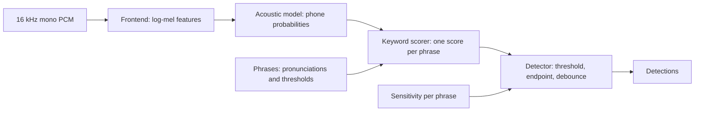

# How Phonlet Wake works

[Documentation](README.md) / How it works

Phonlet Wake listens for phrases with one small acoustic model. The model knows the sounds of
English, not any particular phrase. A phrase is a short description: how it is pronounced, and two
calibrated thresholds that say how sure the engine must be before it fires. Adding a phrase never
retrains the model.

Every SDK runs this same engine, natively or as WebAssembly. No SDK scores keywords or resamples
audio on its own.

## 1. Frontend

Audio is 16 kHz, mono, signed 16-bit PCM, pushed in chunks of any size.

- Pre-emphasis (0.97), then a 512-sample window every 256 samples (16 ms).
- A 512-point FFT gives the power spectrum, and 40 triangular mel bands summarise it.
- Each band's energy is converted to a log value and quantised to a 16-bit integer.
- Two consecutive hops are stacked into one 80-value frame: one model frame every 32 ms
  (512 samples).

The frontend is specified bit for bit: every platform produces identical features, and a golden
test checks a hash of its output.

## 2. Acoustic model (`en-1`)

The model turns each frame into probabilities for 40 classes: the 39 English phones of ARPAbet,
without stress marks, plus a "blank" class meaning no new phone.

| Part | Shape |
| --- | --- |
| Input | 80 features with a fixed per-feature offset and scale |
| Embedding | 80 to 162 |
| 6 recurrent blocks | RMSNorm, minGRU recurrence (162 units), residual; RMSNorm, MLP 162 to 324 to 162 with SiLU, residual |
| Output | RMSNorm, 162 to 40, softmax |

The minGRU cell keeps one hidden state per layer and updates it with a gate and a candidate that
depend only on the current input, so the network can stream frame by frame at constant cost. All
matrices are stored as 8-bit integers with one scale per row; the model file is about 1 MB. It was
trained with the CTC objective on transcribed English speech.

## 3. Keyword scorer

A phrase lists one or more pronunciations, each a sequence of phone ids. For every pronunciation the
scorer runs a Viterbi search over a CTC-style path (each phone, optional blanks between phones,
repeated phones kept apart by a blank) using the model's per-frame phone probabilities in a
log-domain integer scale. The phrase's score is the best recent average over its phones, taken over
all its pronunciations. A path that stays too long or stalls is dropped.

## 4. Detector

- **Threshold.** Each phrase has a loose and a strict threshold. Sensitivity picks a point between
  them: 1 uses the loose one (more detections, more false alarms), 0 the strict one, 0.5 the middle.
  The threshold generator calibrates them so that sensitivity 1 means about 10 false
  alarms per hour of speech, 0.5 about 1, and 0 about 0.1.
- **Endpoint.** For phrases marked `endpoint`, the score is only reported once the speaker has
  paused after the phrase, so "computer" does not fire inside "computerised".
- **Arbitration.** When several phrases pass in the same frame, the one furthest above its own
  threshold wins (`production_arbitrated`, the default). Raw scores of different phrases are not
  compared: a phrase inside another ("assistant" in "hey assistant") often scores higher on the
  longer phrase's audio. `independent` mode reports each phrase on its own.
- **Debounce.** After a detection, no phrase fires for 16 frames (about 0.5 s), so one utterance
  gives one detection; in `independent` mode the wait applies to each phrase separately.
- **Reset.** After about 60 s of continuous silence the scorer and model state are reset, so a long
  quiet stream cannot drift.

A detection reports the phrase, its index, and the frame at which it fired. Per-frame probabilities
stay in memory and are never written anywhere.

## 5. Phrases

A phrase is enrolled from text before it reaches the engine: its words are looked up in a
pronunciation lexicon, unknown words get pronunciations from a grapheme-to-phoneme model, and its
two thresholds are calibrated for this model. The engine only consumes the result. See
[phrases and keyword files](keywords.md) for the formats and how to pass phrases to each SDK.

## 6. Platforms

The engine is C++17 with a small C API (`include/phonlet_wake.h`). Node.js, Python, Java, Android
and .NET wrap that library; the browser uses the same code compiled to
WebAssembly (scalar and SIMD builds). The ESP32-S3 SDK adds its own acoustic engine on the chip's
vector instructions; see [its README](../sdk/esp32/wake/README.md) for the design and measurements.

The engine is compiled with strict floating-point flags (`-ffp-contract=off -fno-fast-math`) so
results do not depend on the compiler or CPU. The ESP32-S3 acoustic engine is the one exception: it
uses 16-bit activations and a lookup-table sigmoid, and is checked against the float engine on
recorded audio instead.

## References

- L. Feng, F. Tung, M. O. Ahmed, Y. Bengio, H. Hajimirsadeghi. *Were RNNs All We Needed?*
  arXiv:2410.01201, 2024. The minGRU recurrence.
- A. Graves, S. Fernández, F. Gomez, J. Schmidhuber. *Connectionist Temporal Classification:
  Labelling Unsegmented Sequence Data with Recurrent Neural Networks.* ICML 2006. The training
  objective and the blank class used by the scorer.
- B. Zhang, R. Sennrich. *Root Mean Square Layer Normalization.* NeurIPS 2019. RMSNorm.
- S. Elfwing, E. Uchibe, K. Doya. *Sigmoid-Weighted Linear Units for Neural Network Function
  Approximation in Reinforcement Learning.* Neural Networks 107, 2018. The SiLU activation.
- S. B. Davis, P. Mermelstein. *Comparison of Parametric Representations for Monosyllabic Word
  Recognition in Continuously Spoken Sentences.* IEEE Transactions on Acoustics, Speech, and Signal
  Processing 28(4), 1980. Mel filterbank features.
- A. J. Viterbi. *Error Bounds for Convolutional Codes and an Asymptotically Optimum Decoding
  Algorithm.* IEEE Transactions on Information Theory 13(2), 1967. The search used by the scorer.
- Carnegie Mellon University. *The CMU Pronouncing Dictionary.* The ARPAbet phone set.
